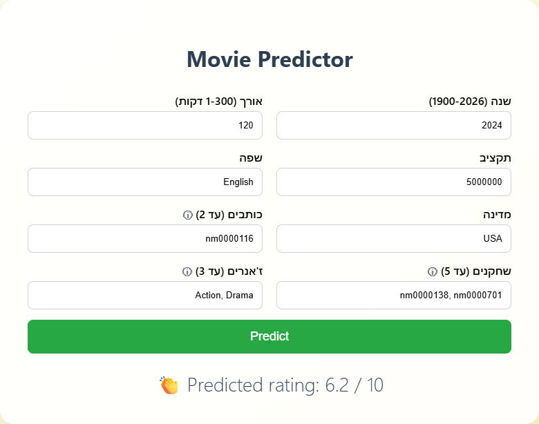

# IMDb Rating Predictor App

> **IMDb rating project series:** [Part 1: Dataset scraping](https://github.com/roeiraz12/imdb-dataset-scraping) · [Part 2: Rating prediction](https://github.com/roeiraz12/imdb-rating-prediction) · **Part 3: Predictor web app** (this repo)

[](https://github.com/roeiraz12/imdb-rating-predictor-app/actions/workflows/ci.yml)



*The web form (Hebrew, right-to-left) with a sample movie: year 2024, 120 minutes, $5M budget, English, USA, two actors, one writer, Action and Drama. The model predicts 6.2 out of 10.*

<div dir="rtl">

**תקציר:** חלק ג' של פרויקט כריית נתונים (שנה ג'). אתר אינטרנט קטן ב-Flask שמגיש את המודל המאומן: המשתמש מזין נתוני סרט (שנה, אורך, תקציב, שפה, מדינה, שחקנים, כותבים וז'אנרים) ומקבל חיזוי של דירוג IMDb. הקלט עובר את אותו עיבוד נתונים מחלק ב' לפני החיזוי.

</div>

---

## Overview

Part 3 of a third-year Data Mining course project turns the Part 2 model into a working web app. A Flask server loads a saved scikit-learn pipeline, a one-page Hebrew (RTL) form collects the details of a movie, and a `/predict` endpoint returns the predicted IMDb rating rounded to one decimal. The same `prepare_data()` logic used in training (`assets_data_prep.py`) is applied to each request, with a special path for single "live" movies so that it does not need the IMDb crew file.

## Project story

- **Problem.** A trained model inside a notebook is hard for anyone else to use. The goal of this part was to put
  the Part 2 model behind a simple web form and API.
- **Approach.** A Flask app that validates the input, applies the same `prepare_data()` feature logic used in
  training to a single movie, builds the 20 selected features and calls the saved scikit-learn pipeline.
- **Context and role.** Academic data-science project for a third-year Data Mining course. This repository
  covers the deployment stage; see [Part 1](https://github.com/roeiraz12/imdb-dataset-scraping) for the dataset and
  [Part 2](https://github.com/roeiraz12/imdb-rating-prediction) for the modeling.

## What was done

- **REST API (`api.py`)**
  - `GET /` serves the form.
  - `POST /predict` takes JSON input and returns `{"predicted_rating": …}` or a clear error with HTTP 400/500.
- **Input validation** – required fields; numeric year, runtime and budget; year 1900–2026 (Part 2 treats years before 1900 as missing); runtime 1–300 minutes; English-only language and country; actors (up to 5) and writers (up to 2) as IMDb person IDs (`nm` + 7–8 digits), genres (up to 3) in English. List fields accept a JSON list (`["nm0000138","nm0000701"]`) or comma-separated text (`nm0000138, nm0000701`), with duplicate and format checks.
- **Feature pipeline at inference** – builds the same 20 Boruta-selected features as in Part 2 (including the five custom features) and fills any missing ones before calling `model.predict`.
- **Front end (`index.html`)** – a small form with a loading spinner that shows the predicted rating out of 10.
- **Model** – `model.pkl` is a scikit-learn `Pipeline` (preprocessing + `HistGradientBoostingRegressor`), the same file as in Part 2.

## Tech stack

Python · Flask · scikit-learn · pandas · NumPy · joblib · HTML/CSS/JavaScript (fetch API)

## Results

This part is a deployment step. It does not include new evaluation numbers; see [Part 2](https://github.com/roeiraz12/imdb-rating-prediction) for the model comparison.

- With the sample request below, `POST /predict` returns `{"predicted_rating": 6.2}`.
- [CI](.github/workflows/ci.yml) installs `requirements.txt` on every push and runs a start-up smoke test
  ([`tests/test_smoke.py`](tests/test_smoke.py)): the model loads, `GET /` serves the form, the sample `/predict`
  request returns HTTP 200 with a numeric rating between 0 and 10, and a request with missing fields returns HTTP 400.

## Repository structure

| File | Description |
|---|---|
| `api.py` | Flask app: routes, input validation, feature building, prediction |
| `assets_data_prep.py` | `prepare_data()` – cleaning and feature engineering shared with training |
| `index.html` | Web form (Hebrew, RTL) |
| `model.pkl` | Trained scikit-learn pipeline |
| `requirements.txt` | Python dependencies |
| `tests/test_smoke.py` | Start-up smoke test run by CI (`pytest tests`) |
| `docs/predictor-form.png` | Screenshot of the form with a prediction |

## How to run

Tested with Python 3.12 on Windows using the pinned `requirements.txt` (scikit-learn must stay at 1.7.2, the version the model was saved with).

```bash
python -m venv venv
venv\Scripts\activate          # Windows; on macOS/Linux: source venv/bin/activate
pip install -r requirements.txt
python api.py
```

Then open <http://127.0.0.1:5000>. `api.py` loads `model.pkl` and serves `index.html` from its own folder, so no extra setup is needed.

**Example request:**

```bash
curl -X POST http://127.0.0.1:5000/predict -H "Content-Type: application/json" \
  -d '{"startYear":"2024","runtimeMinutes":"120","budget":"5000000","Language":"English","Country":"USA","actor_1":"[\"nm0000138\",\"nm0000701\"]","writer_1":"[\"nm0000116\"]","genre_1":"[\"Action\",\"Drama\"]"}'
```

Response: `{"predicted_rating": 6.2}`. In the web form the same values can be typed as comma-separated text, e.g. actors `nm0000138, nm0000701` and genres `Action, Drama`.

## What I'd do next

- Deploy the app to a free host with a production server (for example gunicorn) and a Dockerfile.
- Let users search actors and writers by name instead of typing IMDb person IDs.
- Show a prediction range and the features that pushed the rating up or down, not just one number.
- Store the model with its training metadata (scikit-learn version, feature list) and check them when the app starts.

---

<div dir="rtl">

## פרטים נוספים

## חברי הפרויקט

* **שם:** רועי ראז

---

## מבנה תיקיית העבודה

כל הקבצים הדרושים להרצה נמצאים בתיקייה הראשית של המאגר:

* `model.pkl` - המודל המאומן.
* `assets_data_prep.py` - סקריפט הכנת הנתונים.
* `api.py` - קובץ ה-API הראשי להרצת האתר.
* `index.html` - ממשק המשתמש.
* `requirements.txt` - רשימת הספריות הנדרשות.

---

## הוראות הרצה

פתח חלון `cmd` (שורת פקודה), נווט לתיקיית המאגר ובצע את הפקודות הבאות לפי הסדר:

```bash
python -m venv venv
venv\Scripts\activate
pip install -r requirements.txt
python api.py
```

לאחר הרצת הפקודה האחרונה, האתר יהיה זמין בקישור הבא:
**[http://127.0.0.1:5000](http://127.0.0.1:5000)**

---

## קלט נדרש למשתמש

בעת השימוש באתר, יש להזין את הנתונים לפי ההנחיות הבאות:

1. **שנה:** מספר שלם בין 1900 ל-2026.
2. **שפה:** מחרוזת טקסט.
3. **זמן סרט (בדקות):** מספר שלם בין 1 ל-300.
4. **תקציב:** מספר חיובי (ללא הגבלה עליונה).
5. **ז'אנר:** עד 3 ז'אנרים באנגלית, מופרדים בפסיקים (`Action, Drama`) או כרשימת JSON.
6. **שחקנים:** עד 5 מזהי IMDb (`nm` + 7-8 ספרות), מופרדים בפסיקים או כרשימת JSON.
7. **כותבים:** עד 2 מזהי IMDb (`nm` + 7-8 ספרות), מופרדים בפסיקים או כרשימת JSON.
8. **ארץ:** מחרוזת טקסט.

</div>
